# RetroStone Arcade: the launcher and the game bundle

Several RetroStone VC games and a menu in **one program**: the two Android apps (`apps/android/`: RetroStone Arcade
Free and the paid RetroStone Arcade) and the desktop `dist/windows/RetroStoneArcadeFree.exe` and
`RetroStoneArcade.exe`. The games' code is not changed: they are linked as they are, as **modules**, and an app layer
turns touches into the virtual SNES pad.

| | |
|---|---|
| 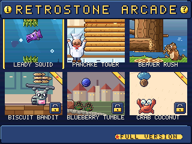 | 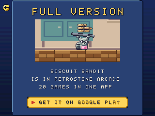 |
| 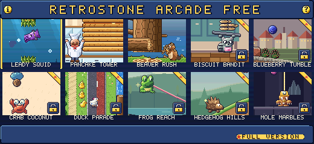 | 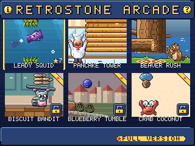 |
| 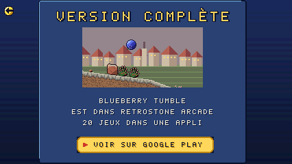 | 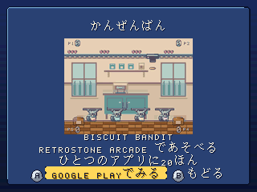 |
| 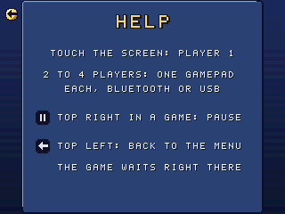 | 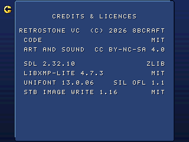 |
| 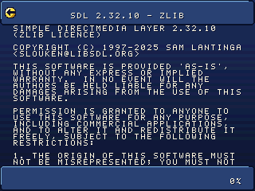 | 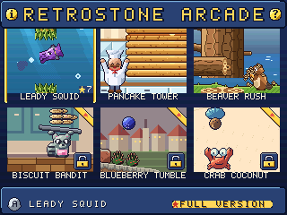 |

## Build and test

```
make -f apps/launcher/bundle.mk                 # build/bundle/host/retrostonearcade (SDL2) and ..._headless
make -f apps/launcher/bundle.mk check           # the tests below
make -f apps/launcher/bundle.mk PLATFORM=win64  # dist/windows/RetroStoneArcadeFree.exe
make -f apps/launcher/bundle.mk PLATFORM=win64 check   # the tests on the Windows build (WSL runs the .exe)
make -f apps/launcher/bundle.mk shots           # apps/launcher/docs/*.png
make -f apps/launcher/bundle.mk CONF=apps/android/app-full.conf [check|PLATFORM=win64]   # the same, the full app
apps/android/build.sh free|full                 # the Android APKs (apps/android/README.md)
```

An app's name, package id, games and (free app) the paid app's link are in **`apps/android/app.conf`** (the free
app, the default) or **`apps/android/app-full.conf`** (the full app: `FREE_GAMES=all`, no locked game, no promotion),
one file per app for Android and the desktop. Everything is built in `build/bundle/<platform>/` (the full app:
`build/bundle/<platform>-full/`); of the root Makefile only the games' generated assets are used
(`tools/game_assets.sh`: one wait for the lock `/tmp/rsvc-build.lock` for all the games).

`check` proves: (1) each playable game started in the bundle gives **exactly the pictures of its standalone build**
for the same input, fresh, at width 520 and after another game ran first in the same process (it also reports which
games are widescreen and which are pillarboxed); (2) the flow with touches: a tap on a card starts the game, taps are
its pad, Back saves its state and returns to the menu, the game resumes where it was (the same picture) and waits for
a tap; free app: a locked card opens "Get the full version", its button asks for the Play Store page, Back closes the
panel; full app: no store request; Back in the menu quits; (3) the credits: the "i" opens the list, a line its
licence's text, a drag scrolls it, Back goes back step by step; (4) every game launches in one process and writes and
resumes its own save state; (5) each game's touch scheme gives pad buttons; (6) the launcher in each of the 22
languages (the menu, the footer, the credits, the free app's panel): the house kit reports no layout error.

## The module system (several games in one binary)

Each game is a standalone program: its `rs_game_main()`, and globals that other games define too. `tools/modulize.py`
links a game into one relocatable object:

1. its objects' writable data (`.data`, `.data.rel`, `.data.rel.local`) are renamed into one section and its `.bss`
   into another (ELF `.data.rsgame` / `.bss.rsgame`; Windows COFF `.data$rsg_<id>_1` / `.bss$rsg_<id>_1`);
2. `ld -r` links `src/rsb_glue.c` (begin markers), the objects, and the glue again (end markers, and the
   descriptor `rsb_module_<id>`: its id, its `rs_game_main`, the bounds of its data and bss): `ld -r` keeps the
   input order inside a section, so the markers bound exactly the game's writable data;
3. `objcopy --keep-global-symbol=rsb_module_<id>` makes every other symbol it defines local; its references to the
   SDK, the house kit and libc stay undefined: **the SDK and the house kit are linked once**, shared by all;
4. checks: no writable data outside the two sections, one global symbol.

A game's translated text (`build/gen/<id>/game_text.c`, docs/i18n.md) registers its pack from a constructor: in one
program all of them would run at load and the last would win, so `modulize.py` renames the call
(`rs_i18n_register` -> `rsb_glue_i18n_register`): the runtime keeps each game's pack and installs it when the game
starts. The games speak the player's language (the phone's; `RS_LANG=fr` or `--lang fr` on the desktop), and so does
the launcher (`strings/`).
The house kit (`games/common`) is a module too (`--house`: its functions stay global). At start-up the runtime copies
every module's data; **each time a game starts, its data is restored and its bss cleared** (and the house kit's), so
a game always starts as in a fresh process, whatever ran before; the SDK resets itself in `rs_host_init()`.

The same object files work on Linux (GNU ld), Android (lld, the NDK's llvm-objcopy) and Windows (mingw ld: the
modules are compiled with `-mcmodel=small`, so no `.refptr` stub is shared between modules).

## The runtime (`src/rsb_runtime.c`)

- One program runs at a time: the launcher, or a game. A game gets `<saves>/<id>.srm` (its battery save) and
  `<saves>/<id>.state` (a save state, written when it is left: Back, the app going to the background, quitting).
  Starting a game loads its state when there is one: it resumes where it was, **held** (the frontend shows a play
  sign) until a touch or a button, and that touch is not passed to the game.
- Touches: `games.cfg` gives each game its scheme (zones of the screen -> pad buttons, some drawn by the frontend
  as translucent buttons, and the button of the small pause button in the corner); they are player 1. A game that
  reads the touches itself (`rs_game.touch_native`, docs/spec.md "Touch") gets them instead, in its screen pixels
  (`rs_host_set_touches`), without zones or drawn buttons: the fingers that went down on its picture, until they are
  lifted. The launcher gets a pointer (`rsb_pointer_get()`) and Back.
- The menu: the "i" (top left) opens Credits & licences, the "?" (top right) a short help (touch is player 1,
  gamepads players 2 to 4, the in-game pause and back buttons); the dialogs close with their back arrow (top left), a
  tap outside them, Back or B. The pad's glyph hints (A, B, the selected game's name in the footer) are shown only
  while a gamepad is connected (`rsb_input.gamepad`; on the desktop, once the keyboard was used); the footer itself
  only when it has something (the free app's "full version" banner, or those hints).
- In a game, the frontend draws a pause button (top right) and a back button (top left, = Back: the state is saved,
  the menu comes back); the runtime keeps their touches from the game (a finger that goes down on one of them; one
  that slides onto them from the game stays the game's).
- Credits & licences: the list of the components and their licences (translated), and each licence's full text
  (English, scrolled). `tools/gen_credits.py` takes the texts
  from the files that come with each component (`LICENSE-*`, SDL2's `LICENSE.txt`, libxmp-lite's README, Unifont's
  OFL, stb_image_write's header), following THIRD_PARTY.md.
- Widescreen: the launcher is laid out on the width the display's aspect asks for (3 columns at 320, 4 at 16:9, 5
  from 520); a game gets that width when it opts in (`rs_game.max_width`, docs/spec.md "Widescreen"), else 320 and
  the frontend draws side borders.
- Buttons held when a program starts are ignored until released (a tap that launched a game does not also start it).

## The cards

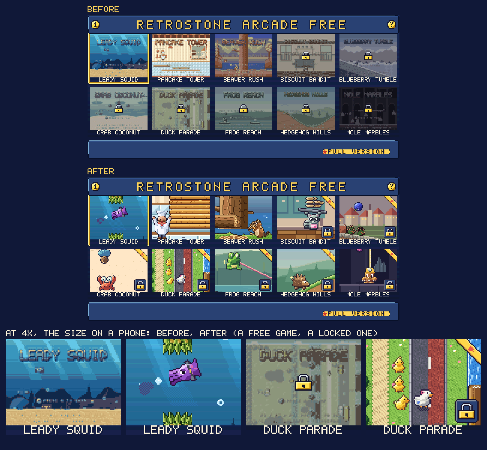

A card shows **a moment of play, pixel for pixel**: 96x72 pixels cut out of the game's screen at 1x, never scaled
(a scaled screenshot blurs pixel art and makes its title unreadable), and no logo (the name is written under it).

- **The table** `cards/cards.cfg`: for each game, the frame of a headless run (the bot plays: `bot=1 ready=1 seed=7`,
  or the line's options), where to cut, and optionally a sprite of the game's art pasted at 1x when no single screen
  shows the scene (Pancake Tower: the chef cheering by his stack). `tools/card_frames.sh [BIN_DIR]` plays each game
  to that frame with its headless runner and keeps the screen as `cards/<id>.png` (320x240, committed: run it after
  a change of a game's look, then look at the cards). A game with no line (a new one) gets the middle of its title
  screen until it has one.
- **The colours** (`tools/cards.py`): each 8x8 tile of a card picks one of 6 palettes of 15 colours (SNES style),
  chosen for that card: the tiles' colour sets are packed into the palettes (most cards keep every colour of the
  game exactly; the others lose a few pixels to the nearest colour). `gen_catalog.py` prints, for each card, its
  palettes and the share of its pixels that are exact. The last measure: the full app, 16 of the 20 cards exact,
  the others 97.1-99.0%; the free app (the locked cards' ribbon and padlock take colours too), 13 exact, the others
  94.8-99.4%; the mean error of a card is at most 0.68 (RGB distance, 0-441), and the launcher's screen shows these
  pixels exactly. One palette of 13 colours for the whole card (the old way) on the same pictures: 31-99% exact,
  mean errors up to 14.
- **On screen** (`src/launcher.c`): the 8 BG palettes cannot hold 6 palettes for each of up to 15 visible cards, so
  each card column is a **viewport** over the grid (docs/spec.md, "Viewports"): the raster callback runs for each line
  of each viewport and loads the palettes of the card under that line before its column is drawn; viewport 0 (the
  whole screen under them) has the backdrop, the header, the footer and the sprites. Nothing in the SDK changed.
- **Locked cards** (the free app): the picture in its own colours (it should make one want the game), a gold ribbon
  across the top-right corner with the red star of the "FULL VERSION" banner, and a padlock badge in the bottom-right
  corner, drawn into the card by `tools/cards.py`.

## Files

| | |
|---|---|
| `src/rsb.h` | the runtime's API (launcher, frontends), the module and catalogue types |
| `src/rsb_runtime.c` | switching, saves, touch mapping |
| `src/launcher.c` | the menu, a RetroStone VC program in the house style |
| `src/rsb_sdl.c` | the SDL2 frontend: Android and desktop (scaling, borders, the pause button and the play sign, lifecycle, the store link) |
| `src/rsb_headless.c` | the test frontend (scripted pad, touches, Back, switches) |
| `src/rsb_glue.c` | the module markers and descriptor |
| `games.cfg` | the touch schemes and best-score locations, per game |
| `strings/` | the launcher's words in the 22 languages (docs/i18n.md format; `tools/launcher_text.py` compiles them with `tools/i18n_build.py`) |
| `cards/` | the cards' table (`cards.cfg`) and the screens they are cut from (`<id>.png`, by `tools/card_frames.sh`) |
| `tools/cards.py` | the cards: the table, the 1x crops, the locked look, the palettes chosen tile by tile |
| `tools/gen_catalog.py` | `build/bundle/gen/catalog.c`: the cards (a moment of play + name), the locked games' pictures, the touch schemes, the app's names. **Every game of `games/` with a `docs/screenshots/title.png` appears, locked unless it is in `FREE_GAMES`** (`all`: none locked); `--list`: the playable games |
| `tools/gen_credits.py` | `build/bundle/gen/credits.c`: the credits screen's components and their licence texts |
| `tools/game_assets.sh` | the games' generated assets from the root Makefile, under one wait for its lock |
| `tools/modulize.py` | the module linker |
| `bundle.mk` | the build |
| `tests/` | `bundle_test.sh`, `shots.sh` |

MIT licence, (c) 2026 Pierre-Louis Boyer (8BCraft).
